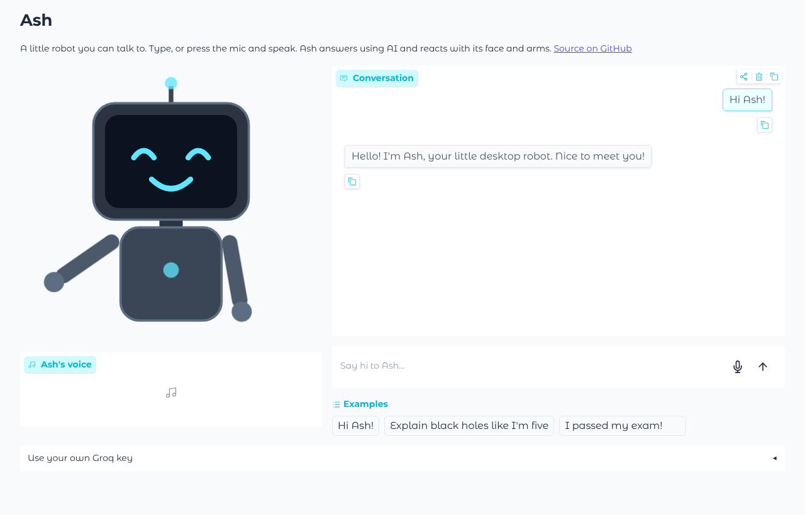
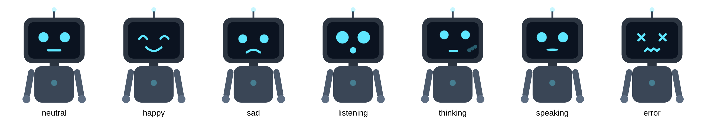

# Ash

A little robot you can talk to. Type or speak, and Ash answers using AI (open models running on Groq), then reacts with its face and arms: it waves when you say hi, points when you ask a question, and cheers when you share good news.

**Try it:** _live demo link goes here once deployed_ (the first load can take a minute while the free server wakes up)



Ash started as a physical robot on a Raspberry Pi, with an LCD face and servo motor arms. I later redesigned it so the same brain can drive either that robot or an animated web version that anyone can try in a browser.

## How it works

```
 you ──► speech-to-text ──► Brain ──► reply + face + gesture ──► Body
        (Whisper)           (ash/brain.py)                       ├─ web avatar (app.py)
                                                                 └─ Raspberry Pi robot (hardware/)
```

- **Brain** (`ash/brain.py`) sends the conversation to an AI model and decides how Ash should react: which face to show and which gesture to make. It knows nothing about screens or motors.
- **Bodies** turn that reaction into something you can see. The web body draws Ash as an animated SVG. The hardware body shows images on an LCD and moves real servos. Gestures are defined once, as servo angles, and both bodies play them.
- **Speech:** Whisper transcribes your voice, and Ash replies using Microsoft Edge's free text-to-speech voices.
- **Model fallback:** the settings list several models in order. If one is busy, rate-limited or retired, Ash moves on to the next instead of crashing.
- **Any provider:** Ash uses the standard OpenAI client pointed at [Groq](https://groq.com)'s free API. Switching to another OpenAI-compatible provider means changing `base_url` and `models` in `config/settings.yaml`.



## Run it locally

You need Python 3.10+ and a free Groq API key from [console.groq.com/keys](https://console.groq.com/keys) (no card needed).

```bash
git clone https://github.com/Lakshya-Inakhiya/Ash.git
cd Ash
python -m venv venv
venv/bin/pip install -r requirements.txt     # on Windows: venv\Scripts\pip
cp .env.example .env                         # then paste your key into .env
venv/bin/python app.py
```

Open http://127.0.0.1:7860 and say hi.

Run the tests with `venv/bin/pip install pytest && venv/bin/pytest`.

## Deploy your own copy

The app runs for free on [Render](https://render.com), which redeploys it whenever `main` changes. GitHub Actions runs the tests on every push.

1. Sign up at [render.com](https://render.com) with your GitHub account.
2. Click **New → Blueprint** and pick this repo. Render reads `render.yaml` and sets everything up.
3. When it asks for `GROQ_API_KEY`, paste your key, then click **Deploy**.

Visitors use your key, so they don't need one. If your free quota runs out, they can paste their own key in the app. On the free plan the app sleeps after 15 minutes without visitors, so the first visit after that takes about a minute to load.

## Project layout

```
app.py              web app (Gradio)
ash/
  brain.py          decides what to say, which face to show, how to move
  llm.py            AI client: replies, speech-to-text, model fallback
  avatar.py         draws Ash as an animated SVG
  voice.py          text-to-speech
config/settings.yaml   AI provider and models, personality, voice, gesture angles
hardware/           the original Raspberry Pi robot (see hardware/README.md)
tests/              pytest tests
```

## Built with

Python, Gradio, Groq (OpenAI-compatible API), Whisper, edge-tts, GitHub Actions, Render. The hardware version adds a Raspberry Pi 5, an SPI LCD driver written from scratch, and PCA9685 servo control.
